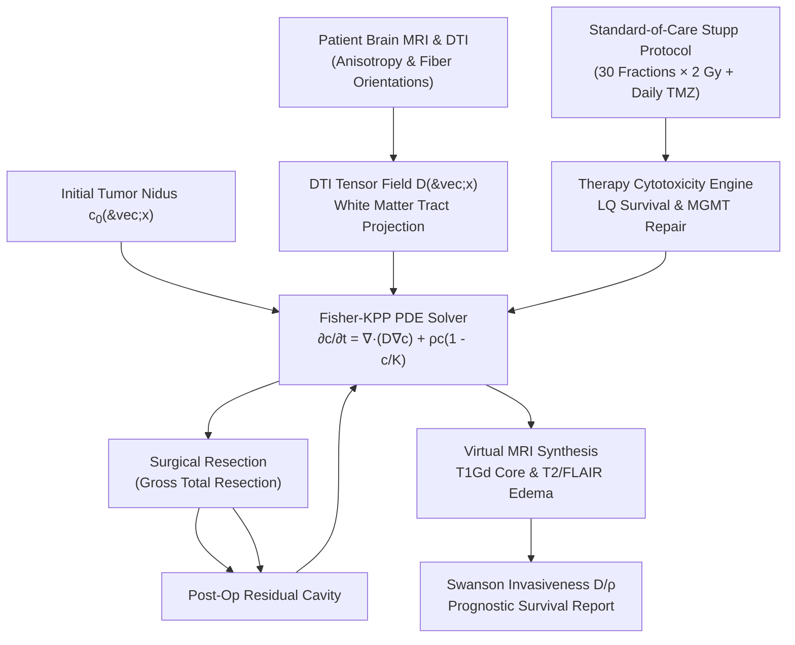

# OncoDiff

[](https://github.com/ZengLLQ/onco-diff/actions/workflows/ci.yml)
[](https://www.python.org/downloads/)
[](https://opensource.org/licenses/MIT)
[](https://doi.org/10.1056/NEJMoa043330)

**OncoDiff** is an in silico computational neuro-oncology simulator and medical AI engine implemented in Python. It models the spatiotemporal evolution of High-Grade Glioma (Glioblastoma Multiforme, GBM) utilizing Diffusion Tensor Imaging (DTI) anisotropic white matter reaction-diffusion (Fisher-Kolmogorov-Petrovsky-Piskunov PDE), radiobiological Linear-Quadratic (LQ) cell kill with hypoxia modulation, alkylating chemotherapy (Temozolomide, TMZ) pharmacodynamics coupled with $O^6$-methylguanine-DNA methyltransferase ($MGMT$) promoter methylation biomarker status, and multi-modal virtual MRI lesion segmentation.

---

## Key Capabilities

- **Anisotropic DTI White Matter Tensor PDE:** Models preferential glioma cell invasion along myelinated axon fiber tracts (e.g. corpus callosum, corticospinal tract) with orientation tensors $\mathbf{D}(\vec{x})$, Fractional Anisotropy (FA), and zero-flux barriers at ventricles and cerebrospinal fluid (CSF).
- **Fisher-KPP Reaction-Diffusion Engine:** High-performance finite-difference numerical solver with logistic proliferation saturation $\rho \cdot c \cdot (1 - c/K)$ and CFL-governed time integration.
- **Linear-Quadratic (LQ) Radiobiology:** Simulates standard fractionated radiotherapy (e.g., 60 Gy in 30 fractions of 2 Gy) with cell surviving fraction $S(d) = \exp(-\alpha d - \beta d^2)$ and hypoxia-mediated radioresistance ($pO_2$).
- **Temozolomide (TMZ) Pharmacodynamics & MGMT Biomarker:** Integrates systemic drug exposure with epigenetic $MGMT$ promoter methylation status, capturing dramatic differences in DNA cross-link repair and chemoresistance.
- **Surgical Resection Cavity Simulator:** Gross Total Resection (GTR) modeling with customizable macroscopic density thresholds and microscopic infiltrative safety margins.
- **Virtual MRI Multi-Modal Lesion Generator:** Synthesizes clinical neuroimaging biomarkers: T1Gd enhancing core ($c \ge 0.80$), T2/FLAIR hyperintense edema and infiltration ($c \ge 0.16$), and invisible sub-radiological invasion ($0.01 \le c < 0.16$).
- **Swanson Invasiveness & Prognostic Stratification:** Computes the biophysical invasiveness ratio $D/\rho$ ($mm^2$) to classify nodular vs diffuse glioma phenotypes and predict median survival.

---

## Architectural Workflow



---

## Mathematical & Biophysical Foundations

### 1. Anisotropic Fisher-KPP Reaction-Diffusion PDE

Glioma cell density $c(\vec{x}, t) \in [0, K]$ across spatial coordinate $\vec{x}$ and time $t$ obeys:

$$\frac{\partial c(\vec{x}, t)}{\partial t} = \nabla \cdot \left(\mathbf{D}(\vec{x}) \nabla c(\vec{x}, t)\right) + \rho \cdot c(\vec{x}, t) \left(1 - \frac{c(\vec{x}, t)}{K}\right) - \mathcal{R}_{radiation}(c, t) - \mathcal{C}_{TMZ}(c, t)$$

where $\rho$ is the net cell proliferation rate ($day^{-1}$), $K$ is the tissue carrying capacity ($cells/mm^3$), and $\mathbf{D}(\vec{x})$ is the spatially varying diffusion tensor.

### 2. Diffusion Tensor Imaging (DTI) & Axonal Anisotropy

Tumor cell motility is 5–10 times faster along aligned myelinated axonal tracts than in isotropic gray matter:

$$\mathbf{D}(\vec{x}) = D_{trans} \mathbf{I} + (D_{long} - D_{trans}) (\vec{v} \vec{v}^T)$$

where $\vec{v}$ is the normalized principal eigenvector of the local DTI tensor. The point-wise Fractional Anisotropy (FA) is defined as:

$$FA = \sqrt{\frac{3}{2}} \frac{\sqrt{(\lambda_1 - \bar{\lambda})^2 + (\lambda_2 - \bar{\lambda})^2 + (\lambda_3 - \bar{\lambda})^2}}{\sqrt{\lambda_1^2 + \lambda_2^2 + \lambda_3^2}}$$

```
     Axonal Fiber Tract Direction (v)
  ===========================================>  High Diffusion (D_long)
       |           |           |
       |           |           |                Low Diffusion (D_trans)
       v           v           v
  ===========================================>
```

### 3. Linear-Quadratic Radiobiology & Hypoxia

Surviving fraction following absorbed radiation dose $d$ (Gy) is modeled via the standard Linear-Quadratic (LQ) equation:

$$S(d) = \exp\left(-\alpha_{eff} d - \beta_{eff} d^2\right)$$

In hypoxic/necrotic regions ($pO_2 < 10\text{ mmHg}$), radiosensitivity is reduced by the hypoxia reduction factor $\kappa_{hyp}$:

$$\alpha_{eff} = \alpha \cdot \kappa_{hyp}, \quad \beta_{eff} = \beta \cdot \kappa_{hyp} \quad (\kappa_{hyp} \approx 0.4 - 0.5)$$

### 4. Alkylating Temozolomide (TMZ) & MGMT Repair

Temozolomide induces $O^6$-methylguanine DNA cross-links. The cell kill rate $\mathcal{C}_{TMZ}$ depends on the epigenetic promoter methylation of $MGMT$:

$$\mathcal{C}_{TMZ} = k_{max} \cdot \frac{C_{plasma}}{EC_{50} + C_{plasma}} \cdot \chi_{MGMT} \cdot c$$

$$\chi_{MGMT} = \begin{cases} 1.0, & \text{MGMT Promoter Methylated (Silenced DNA Repair)} \\ 0.35, & \text{MGMT Unmethylated (Active Repair / Resistant)} \end{cases}$$

### 5. Swanson Invasiveness Ratio ($D/\rho$) & Virtual MRI

- **Swanson Ratio ($D/\rho$):**
  $$\text{Invasiveness} = \frac{D_w}{\rho} \quad (mm^2)$$
  - $D/\rho \ge 4.0\text{ mm}^2$: Diffuse, widely infiltrative phenotype; sub-radiological margins extend $>2-3\text{ cm}$ beyond T2/FLAIR hyperintensity.
  - $D/\rho < 1.5\text{ mm}^2$: Nodular, circumscribed phenotype; amenable to high surgical resection efficacy.

- **Virtual MRI Thresholds:**
  - **T1Gd Enhancing Core:** $c(\vec{x}) \ge 0.80$ (Gross Tumor Volume, GTV)
  - **T2/FLAIR Hyperintensity:** $c(\vec{x}) \ge 0.16$ (Clinical Target Volume, CTV)
  - **Invisible Infiltration:** $0.01 \le c(\vec{x}) < 0.16$ (Undetectable on routine MRI; primary cause of local relapse)

---

## Installation

```bash
git clone https://github.com/ZengLLQ/onco-diff.git
cd onco-diff
pip install -e .
```

For development and test dependencies:

```bash
pip install -e ".[dev]"
```

---

## Command-Line Interface (CLI)

```bash
# 1. Inspect CLI options
onco-diff --help

# 2. Simulate untreated glioma invasion along white matter tracts
onco-diff simulate --days 60 --diff-wm 0.15 --rho 0.025

# 3. Simulate Stupp Protocol (Surgical Resection + 60 Gy Radiotherapy + TMZ)
onco-diff stupp --days 90 --mgmt-methylated

# 4. Evaluate Swanson D/rho ratio and patient survival prognosis
onco-diff prognosis --diff 0.18 --rho 0.025 --mgmt-methylated
```

### Sample Clinical Stupp Output:
```text
======================================================================
    OncoDiff: Spatiotemporal Glioblastoma Neuro-Oncology Report      
======================================================================
  VIRTUAL MRI TUMOR SUB-REGION VOLUMES:
    T1Gd Enhancing Core (GTV)      :   0.00 cm^3 (Dense tumor >= 0.80)
    T2/FLAIR Hyperintensity (CTV)  :   0.12 cm^3 (Edema & invasion >= 0.16)
    Sub-radiological Infiltration  :   0.45 cm^3 (Microscopic margin)
    Estimated Total Cell Burden    :    4.2 normalized units
----------------------------------------------------------------------
  BIOPHYSICAL INVASIVENESS & PROGNOSTIC STRATIFICATION:
    Diffusion Coefficient D        :  0.150 mm^2/day
    Proliferation Rate rho         :  0.025 /day
    Swanson Invasiveness Ratio     :   6.00 mm^2 (D/rho)
    Tumor Invasiveness Phenotype   : DIFFUSE_INFILTRATIVE
    Recurrence Risk Level          : EXTREME
    Predicted Median Survival      : 22.5 months
----------------------------------------------------------------------
  CLINICAL ONCOLOGY GUIDANCE:
    Recommendation                 : Highly diffuse infiltration (D/rho = 6.00 mm^2). Sub-radiological margins extend > 2-3 cm beyond visible T2/FLAIR hyperintensity. Extended margin radiotherapy and adjuvant TMZ mandatory. MGMT promoter is METHYLATED: Expect robust response to alkylating Temozolomide.
======================================================================
```

---

## Python API Quickstart

### Simulating Anisotropic Glioma Invasion

```python
import numpy as np
from onco_diff.pde import DTITensorField, GliomaReactionDiffusionSolver
from onco_diff.therapies import RadiotherapyProtocol, ChemotherapyRegimen, TemozolomideParameters
from onco_diff.imaging import VirtualMRIGenerator, TumorBiomarkerEvaluator

# 1. Set up Brain Domain & DTI White Matter Tracts
dim = 30
field = DTITensorField((dim, dim), voxel_size_mm=1.0)
y, x = np.ogrid[:dim, :dim]
corpus_callosum = (y >= 13) & (y <= 17)
field.set_white_matter_tract(corpus_callosum, principal_direction=[0.0, 1.0], anisotropy_ratio=6.0)

# 2. Seed Initial Glioblastoma Nidus
c0 = np.zeros((dim, dim))
c0[14:16, 14:16] = 0.90

# 3. Simulate Spatiotemporal Spread
solver = GliomaReactionDiffusionSolver(field)
history = solver.simulate(c0, total_days=30.0, dt_days=0.15)

# 4. Generate Multi-Modal Virtual MRI Segmentations
mri_gen = VirtualMRIGenerator()
seg = mri_gen.segment_tumor(history.final_density)

print(f"T1Gd Enhancing Core Volume: {seg.t1gd_volume_cm3:.2f} cm^3")
print(f"T2/FLAIR Edema/Invasion:   {seg.t2_flair_volume_cm3:.2f} cm^3")
```

---

## Verification & Test Suite

The test suite validates DTI tensor anisotropy, Fisher-KPP mass bounds, Linear-Quadratic survival fractions, and MGMT methylation response:

```bash
pytest -v
```

```text
tests/test_anisotropy.py::test_dti_isotropic_initialization PASSED
tests/test_anisotropy.py::test_dti_white_matter_tract_anisotropy PASSED
tests/test_anisotropy.py::test_csf_ventricles_zero_diffusion PASSED
tests/test_chemotherapy.py::test_chemotherapy_mgmt_methylation_sensitivity PASSED
tests/test_chemotherapy.py::test_chemotherapy_apply_kill PASSED
tests/test_cli.py::test_cli_help PASSED
tests/test_cli.py::test_cli_simulate PASSED
tests/test_cli.py::test_cli_stupp PASSED
tests/test_cli.py::test_cli_prognosis PASSED
tests/test_fisher_kpp.py::test_fisher_kpp_growth_and_bounds PASSED
tests/test_fisher_kpp.py::test_csf_containment PASSED
tests/test_radiotherapy.py::test_linear_quadratic_surviving_fraction PASSED
tests/test_radiotherapy.py::test_surgical_resection PASSED
tests/test_virtual_mri.py::test_virtual_mri_segmentation PASSED
tests/test_virtual_mri.py::test_swanson_invasiveness_prognosis PASSED
============================= 15 passed in 2.62s ==============================
```

---

## Clinical References

1. **Stupp, R., et al. (2005).** *Radiotherapy plus concomitant and adjuvant temozolomide for glioblastoma.* New England Journal of Medicine, 352(10), 987-996.
2. **Swanson, K. R., Bridge, C., Murray, J. D., & Alvord, E. C. (2000).** *Virtual and real brain tumors: using mathematical modeling to quantify glioma growth and invasion.* Journal of the Neurological Sciences, 181(1-2), 156-170.
3. **Jbabdi, S., et al. (2005).** *Simulation of anisotropic growth of low-grade gliomas using diffusion tensor imaging.* Magnetic Resonance in Medicine, 54(3), 616-624.
4. **Hegi, M. E., et al. (2005).** *MGMT gene silencing and benefit from temozolomide in glioblastoma.* New England Journal of Medicine, 352(10), 997-1003.

---

## License

This project is licensed under the MIT License - see the [LICENSE](LICENSE) file for details.
